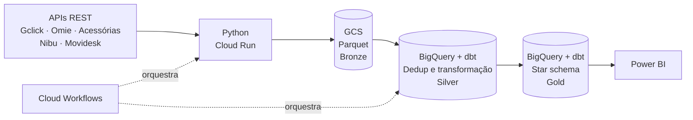

<h1 align="center">Rodrigo Kreusch</h1>
<h3 align="center">Analytics Engineer</h3>

  ELT · dbt · Modelagem dimensional · Data Warehouse · Google Cloud · Power BI

---

## Sobre

Analytics Engineer na Genial Dash (BI as a Service). Projeto a camada entre a fonte e o dashboard: ingestão via API, armazenamento em Parquet, transformação e deduplicação em SQL e dbt no BigQuery, e modelos em esquema estrela prontos para consumo no Power BI.

**Foco técnico:** arquitetura medalhão · ELT · modelagem dimensional · performance analítica · pipelines containerizados.

---

## Arquitetura de referência

| Camada | Tecnologia | Responsabilidade |
|---|---|---|
| **Ingestão** | Python, Docker, Cloud Run | Extração completa via API, escrita em Parquet |
| **Bronze** | Cloud Storage (Parquet) | Dado cru, formato colunar e barato |
| **Silver** | BigQuery, SQL, dbt | Deduplicação, tipagem e limpeza |
| **Gold** | BigQuery, dbt | Fatos e dimensões em esquema estrela |
| **Consumo** | Power BI (DAX) | Medidas e visualização sobre modelo já pronto |
| **Orquestração** | Cloud Workflows | Encadeamento e agendamento dos jobs |

---

## Decisões de engenharia

Escolhas que fiz e os trade-offs por trás delas:

- **Pipeline em Cloud Run em vez de consumir a API direto no Power BI.** Mais código para manter, mas o tempo de extração caiu 80% e as falhas de consistência acabaram. A regra de negócio sai do relatório e vai para uma camada versionada.
- **Parquet no GCS antes do BigQuery.** Um passo a mais na arquitetura, em troca de custo baixo de armazenamento, histórico reprocessável e desacoplamento entre extração e transformação.
- **ELT com transformação no BigQuery.** Usa o poder do warehouse e mantém a lógica em SQL, ao custo de pagar processamento a cada execução, o que pede atenção a particionamento e consultas incrementais.
- **dbt para a camada de transformação.** Traz versionamento, testes e documentação dos modelos, mas adiciona uma ferramenta para operar e exige disciplina de convenções no projeto.
- **Esquema estrela no consumo.** Modelo mais previsível e rápido no Power BI, com custo extra de modelagem antecipada.
- **Refresh incremental** para grandes volumes, em vez de recarga total.

---

## Stack

**Linguagens**

**Google Cloud**

**Transformação e modelagem**

**Bancos e BI**

**Infra e automação**

---

## Entregas

- **Lakehouse completo** com extração total via API do Gclick, base técnica para o lançamento de um novo produto.
- **Redesenho de pipeline:** de consumo direto de API no Power BI para ELT containerizado, com redução de 80% no tempo de extração.
- **Integração de 5 sistemas** (Gclick, Acessórias, Omie, Nibu, Movidesk) na mesma arquitetura medalhão.
- **Produto de inteligência comercial** para varejo e indústria, hoje padrão do segmento.
- **Power BI de alta performance** com DAX avançado, Star Schema, views/CTEs e refresh incremental.
- **Governança no Power BI Service e Fabric:** Dataflows, Gateways e monitoramento de falhas.

---

## Projetos públicos

<!-- Fixe 3 a 6 repositórios. Sugestão: reproduza a arquitetura acima com uma API pública (API, Parquet, BigQuery, modelo estrela com dbt). -->

- **[nome-do-projeto]**: pipeline Python → GCS → BigQuery em arquitetura medalhão.
- **[nome-do-projeto]**: modelagem dimensional com dbt sobre dados públicos.

---

## Contato

