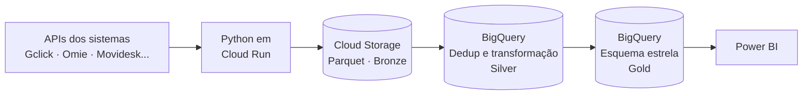

<h1 align="center">Rodrigo Adriano Kreusch</h1>
<h3 align="center">Analytics Engineer · BI & Data Engineering</h3>

  Pipelines ELT, modelagem dimensional e BI no Google Cloud. 
  Engenharia de dados com olhar de quem já trabalhou na contabilidade.

---

## 👋 Sobre mim

Sou Analytics Engineer na **Genial Dash**, empresa de *BI as a Service* para escritórios de contabilidade. Projeto e implemento arquiteturas de ingestão e modelagem dimensional, do dado bruto na API até o dashboard no Power BI.

Antes de entrar em dados, passei mais de 4 anos na rotina fiscal e contábil (apuração de ICMS, TTD, obrigações acessórias, fechamento de IRPJ/CSLL). Foi lá que comecei a automatizar processos com Python, e isso me dá um diferencial: entendo o negócio do cliente que está do outro lado do dashboard.

**Foco atual:** arquitetura medalhão, ELT no GCP, modelagem em esquema estrela e performance analítica.

---

## Stack

**Linguagens:**

**Google Cloud:**

**Dados e BI:**

**Automação, infra e design:**

---

## Arquitetura que eu construo

Padrão medalhão em ELT dentro do GCP:

---

## Resultados em destaque

- **Lakehouse do zero** com extração completa via API do Gclick, viabilizando a comercialização de um novo produto estratégico na empresa.
- **-80% no tempo de extração** ao substituir o consumo direto de APIs no Power BI por pipelines containerizados no Cloud Run, eliminando também falhas de consistência.
- **Integrações com vários sistemas** (Gclick, Acessórias, Omie, Nibu, Movidesk) dentro de uma mesma arquitetura reaproveitável.
- **Novo produto de inteligência comercial** para varejo e indústria, incorporado como produto padrão do segmento.
- **Dashboards de alta performance** com DAX avançado, Star Schema e refresh incremental para grandes volumes (EVNE).
- **Prototipação rápida no Figma** para validar layout e funcionalidade com o cliente antes do desenvolvimento.

---

## Trajetória

| Período | Onde | Papel |
|---|---|---|
| 12/2025 → hoje | **Genial Dash** | Analytics Engineer · BI & Data Engineering |
| 06/2025 → 11/2025 | **EVNE Tecnologia** | Analista de BI |
| 2021 → 2024 | Escritórios de contabilidade | Auxiliar Fiscal/Contábil (automação em Python e Golang) |

Bacharel em Ciências Contábeis · Unidavi
Modelagem de Dados Essencial · Python Data Structures · EF SET English C1 Advanced (61/100)

---

## Projetos públicos

<!-- Fixe 3 a 6 repositórios no perfil e liste aqui. Sugestão: projetos pessoais com dados públicos que reproduzam sua arquitetura, já que o trabalho em empresa é confidencial. -->

- **[nome-do-projeto]**: pipeline Python → Parquet → BigQuery em arquitetura medalhão.
- **[nome-do-projeto]**: modelo dimensional e dashboard de exemplo.

---

## 📬 Contato

<i>Transformando informação em valor.</i>

